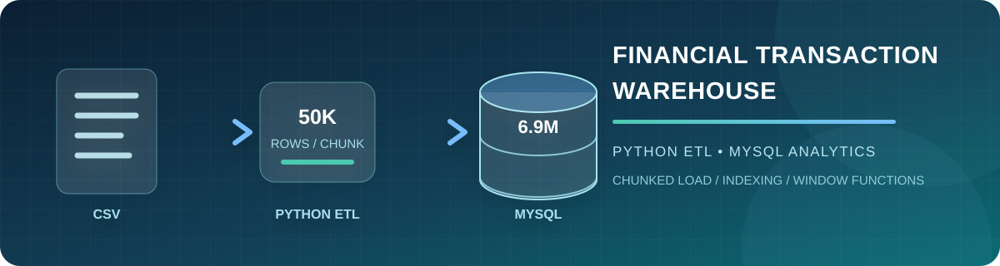
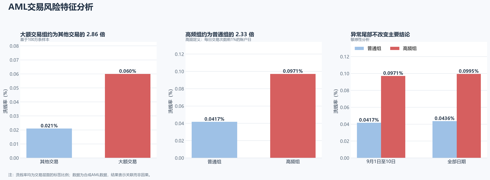
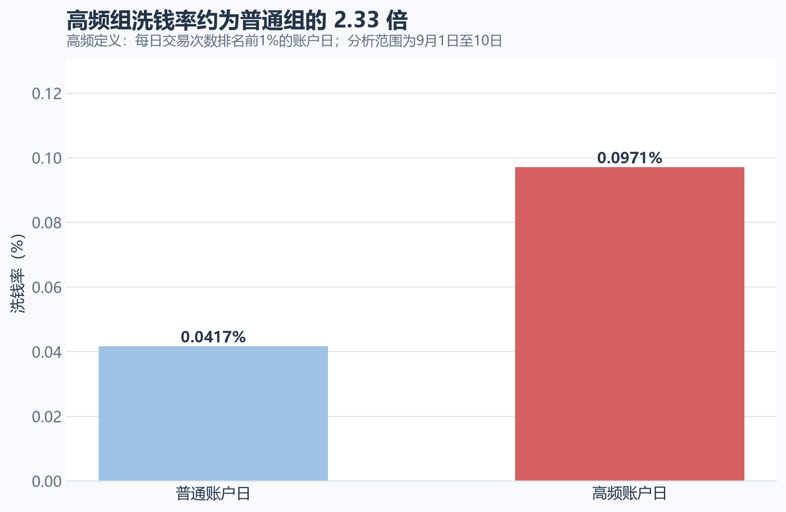
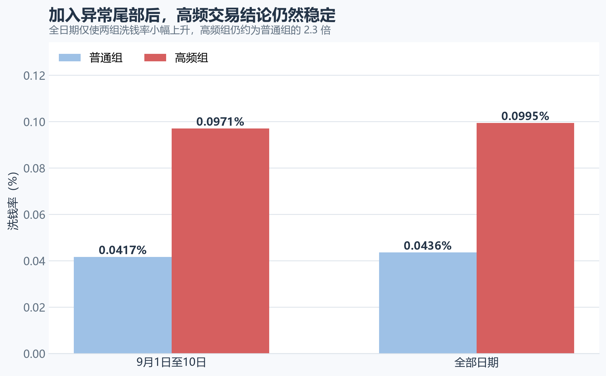
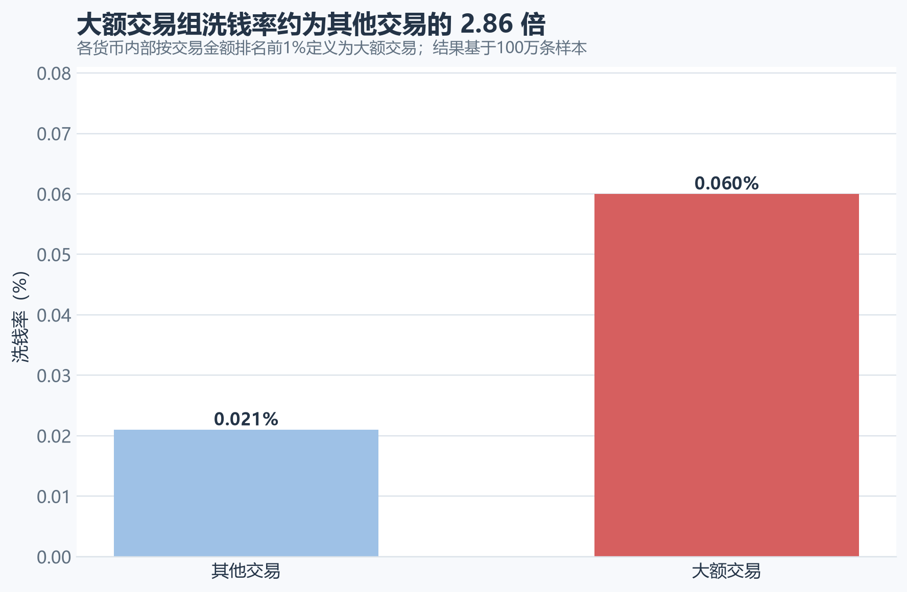
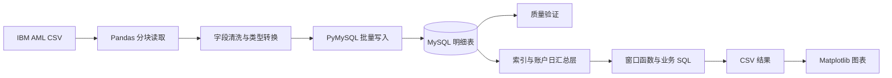

<div align="center">



# 百万级金融交易 ETL 与 SQL 分析

Python 分块导入 692 万笔交易，使用 MySQL 分析交易频次、金额与洗钱标签的关系。

[](https://www.python.org/)
[](https://www.mysql.com/)
[](https://pandas.pydata.org/)

[](https://cdla.dev/sharing-1-0/)

[项目摘要](#项目摘要) · [工程实现](#工程实现) · [分析结果](#分析结果) · [技术路线](#技术路线) · [快速复现](#快速复现)

</div>

## 项目摘要

这个项目使用 IBM AML-Data 的合成交易数据，练习大文件导入和 MySQL 分析。Python 负责分块读取 CSV、转换字段并批量入库；SQL 负责校验数据、建立索引和账户日汇总表，再比较高频、大额交易与其他交易的洗钱标签比例。

分析围绕三个问题展开：不同币种的交易笔数和金额分布有什么差异？高频账户的交易是否更常带有洗钱标签？各币种中金额排名靠前的交易是否也有类似表现？

| 原始文件 | 完整交易数 | 洗钱标签数 | 读取块大小 | 插入批次 |
|:---:|:---:|:---:|:---:|:---:|
| 约 620 MB | 6,924,049 | 3,565 | 50,000 行 | 5,000 行 |

原始数据保存在本地，数据库连接信息放在 `.env` 中，两者都通过 `.gitignore` 排除。

## 工程实现

### 1. 分块读取与批量入库

Pandas 读取 CSV 后的内存占用通常高于文件体积。为减少一次性加载的数据量，导入脚本使用 `read_csv(..., chunksize=50_000)`，每次处理 50,000 行。脚本先统一列名，将时间转为日期时间类型、标签转为整数，再写入 MySQL。

| 处理环节 | 做法 | 原因 |
|---|---|---|
| CSV 读取 | 每块 50,000 行，按字符串读取 | 减少内存占用，保留账户编号原貌 |
| 字段转换 | 统一 11 个列名，转换时间和标签 | 对应 MySQL 表字段及类型 |
| 批量写入 | `executemany` 每批写入 5,000 行 | 减少逐行提交 SQL 的开销 |
| 事务提交 | 每块独立提交，数据库写入失败时回滚当前块 | 限制单次事务规模 |

导入脚本见 [`src/import_transactions_chunked.py`](src/import_transactions_chunked.py)。[`src/import_transactions.py`](src/import_transactions.py) 保留了早期一次性读取开发样本的版本，便于对照两种读取方式。

### 2. 数据完整性验证

导入后，运行 SQL 核对以下结果：

- 总行数是否为 `6,924,049`；
- 洗钱标签交易数是否为 `3,565`；
- 最早与最晚交易时间是否覆盖原始数据范围；
- 标签 `0/1` 的记录数是否与源数据一致。

验证脚本见 [`sql/02_validate_import.sql`](sql/02_validate_import.sql)。

### 3. SQL 分析层与性能优化

高频交易分析先按日期、付款银行和付款账户汇总，再按每日交易次数排名。最初直接在 692 万行明细表上执行分组和窗口计算，首次查询耗时超过 2 分钟。

因此，将账户日聚合结果保存到 `daily_account_stats`，后续排名和风险率计算直接读取汇总表，避免每次从明细表重新聚合。明细表为交易时间、付款账户及币种金额建立索引，汇总表为日期和每日交易次数建立联合索引。

```text
transactions（6,924,049 笔交易）
        │
        ├── 明细索引：时间 / 付款账户 / 币种金额
        │
        └── daily_account_stats（账户日汇总层）
                         │
                         └── 高频排名 / 风险率 / 敏感性分析
```

建表与索引脚本见 [`sql/03_build_analytics_layer.sql`](sql/03_build_analytics_layer.sql)。

## 分析结果

币种分析分别统计各支付币种的交易笔数、总金额、平均金额和最大金额，并计算交易笔数占比。金额只在同一币种内汇总；跨币种比较使用交易笔数及占比。下面列出高频和大额交易的对比结果。



### 高频交易与洗钱标签

以付款银行和付款账户共同标识账户，每个账户在一天内的交易构成一个账户日。使用 `NTILE(100)` 按当天交易次数降序分组，第一组记为高频组，约占当天账户日的 1%。

下表使用 2022 年 9 月 11 日之前的交易；之后交易稀疏的日期单独做敏感性分析。表中的洗钱率指带有洗钱标签的交易占组内交易总数的比例。

| 组别 | 账户日数量 | 交易数 | 带洗钱标签的交易数 | 洗钱率 |
|---|---:|---:|---:|---:|
| 高频组 | 21,185 | 979,344 | 951 | 0.0971% |
| 普通组 | 2,096,823 | 5,944,482 | 2,480 | 0.0417% |

高频组的标签比例约为普通组的 2.33 倍。不过，两组的绝对比例都低于 0.1%。在这份数据中，高频交易与洗钱标签有关联，单凭交易频次仍不足以判断一笔交易是否涉及洗钱。

### 异常尾部敏感性分析

2022 年 9 月 11 日至 17 日只有 223 笔交易，其中 134 笔带有洗钱标签，与此前日期的分布差异较大。为检查日期范围对结果的影响，纳入这部分交易后重新计算：高频组与普通组的标签比例分别为 `0.0995%` 和 `0.0436%`，相对倍数从 `2.33` 变为 `2.28`。高频组的比例仍高于普通组。

<table>
  <tr>
    <td width="50%"></td>
    <td width="50%"></td>
  </tr>
  <tr>
    <td align="center">高频账户日与普通账户日对比</td>
    <td align="center">纳入稀疏日期后的对比</td>
  </tr>
</table>

### 大额交易与洗钱标签

这部分使用早期的 100 万行开发样本，在各支付币种内按付款金额降序排列，用 `NTILE(100)` 将第一组记为大额交易，约占该币种交易的 1%。按币种分别排名，是因为不同币种的金额不能直接比较。

- 大额交易组：10,007 笔交易，6 笔洗钱标签，洗钱率 `0.060%`；
- 其他交易组：989,993 笔交易，208 笔洗钱标签，洗钱率 `0.021%`。
大额组的标签比例约为其他交易的 2.86 倍，但这一结果只涉及 6 笔带洗钱标签的大额交易，样本数量较少。它也不能与全量数据中主要日期的高频分析直接作同口径比较。



业务查询集中在 [`sql/04_business_analysis.sql`](sql/04_business_analysis.sql)，图表由 [`src/visualize_results.py`](src/visualize_results.py) 生成。

## 技术路线



## 项目结构

```text
financial-transaction-warehouse/
├── data/
│   ├── raw/                         # 原始数据，不进入 Git
│   └── processed/                   # 开发样本，不进入 Git
├── docs/assets/                     # README 横幅素材
├── outputs/figures/                 # 代码生成的分析图表
├── sql/
│   ├── 01_create_schema.sql
│   ├── 02_validate_import.sql
│   ├── 03_build_analytics_layer.sql
│   └── 04_business_analysis.sql
├── src/
│   ├── create_sample.py
│   ├── import_transactions.py
│   ├── import_transactions_chunked.py
│   ├── test_connection.py
│   └── visualize_results.py
├── .env.example
├── .gitattributes
├── .gitignore
├── README.md
└── requirements.txt
```

## 快速复现

项目使用 Python 3.13 和 MySQL 8.0+。以下命令在项目根目录下执行。

### 1. 安装依赖

```powershell
python -m venv .venv
.\.venv\Scripts\Activate.ps1
python -m pip install -r requirements.txt
Copy-Item .env.example .env
```

在 `.env` 中填写本地 MySQL 连接信息。

### 2. 准备数据与数据库

通过 [IBM AML-Data](https://github.com/IBM/AML-Data) 提供的数据下载入口获取 `LI-Small_Trans.csv`，保存到：

```text
data/raw/LI-Small_Trans.csv
```

在 MySQL 中运行 [`sql/01_create_schema.sql`](sql/01_create_schema.sql)，然后执行：

```powershell
python src/test_connection.py
python src/import_transactions_chunked.py
```

### 3. 验证并分析

按顺序运行：

```text
sql/02_validate_import.sql
sql/03_build_analytics_layer.sql
sql/04_business_analysis.sql
```

图表脚本读取项目根目录下的 `大额交易与洗钱关系.csv`、`高频交易与洗钱率.csv` 和 `末端敏感性分析.csv`。仓库已包含这些结果，执行下面的命令即可重新生成图表；重新导入并分析数据后，可用相同文件名及列名更新结果 CSV。

```powershell
python src/visualize_results.py
```

导入器按块提交，尚不支持断点续传。中途失败时，已提交的数据会保留。从头重跑前需要先清空目标交易表，避免重复导入。

## 数据来源与使用边界

- 数据来源：[IBM AML-Data](https://github.com/IBM/AML-Data)
- 论文：[Realistic Synthetic Financial Transactions for Anti-Money Laundering Models](https://proceedings.neurips.cc/paper_files/paper/2023/file/5f38404edff6f3f642d6fa5892479c42-Paper-Datasets_and_Benchmarks.pdf)
- 数据许可：[Community Data License Agreement – Sharing – Version 1.0](https://cdla.dev/sharing-1-0/)

IBM 使用多智能体虚拟世界模型生成了这份合成数据。`Is Laundering` 是模拟数据的标签，分析结果仅描述这份数据中的关联，不能直接外推到真实银行业务，也不能作为真实交易的判定依据。

## 已知限制

- 大额交易使用原始文件前 100 万行，未做随机抽样；高频交易使用全量数据中的主要日期，并另做包含稀疏日期的敏感性分析。两种分析的样本范围不同。
- `NTILE(100)` 可能把交易次数相同的账户日分到相邻组别。
- 不同币种没有统一汇率，金额不能跨币种直接求和比较。
- 洗钱标签极少，解读倍数差异时需要同时看绝对比例和带标签的交易数量。
- 当前导入器不具备幂等写入和断点续传能力。
